<div align="center">

# FocusGuard

**Dual-Engine Hardware-Aware Focus Timer & Desk-Sentry Anti-Theft Utility**  
*Aplikasi Mobile Native Berbasis Sensor Fisik Perangkat Keras untuk Produktivitas & Keamanan Meja Belajar Mahasiswa*

[](https://github.com/Gar07/FocusGuard/releases)
[](https://github.com/Gar07/FocusGuard/actions)
[](LICENSE)
[](https://developer.android.com/)
[](https://www.java.com/)
[-007ACC.svg?style=for-the-badge)](https://developer.android.com/about/dashboards)
[-blue.svg?style=for-the-badge)](https://developer.android.com/)
[](https://github.com/Gar07/FocusGuard)
[](.github/dependabot.yml)

<br/>

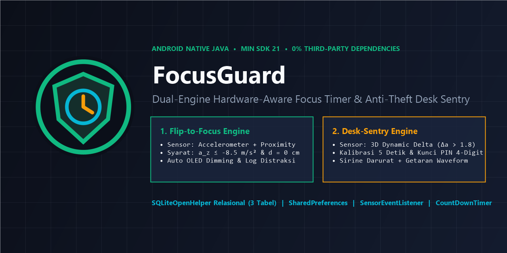

</div>

---

## 📌 Dokumen Publik, Rilis & Presentasi Proyek

| Jenis Dokumen | Format / Platform | Akses Langsung |
| :--- | :--- | :--- |
| **Official GitHub Release (v1.0.0)** | GitHub Release Page | [Buka Rilis v1.0.0](https://github.com/Gar07/FocusGuard/releases/tag/v1.0.0) |
| **Product Requirements Document (PRD)** | Google Docs (Live Cloud) | [Buka di Google Docs](https://docs.google.com/document/d/1t3Hd_1S1vkxu7yhWYbjRagOk1BW-0kDKUo4mkP3NMNA/edit) |
| **Panduan & Cetak Biru Proyek** | Dokumen PDF Resmi | [`docs/Panduan_Project_FocusGuard.pdf`](docs/Panduan_Project_FocusGuard.pdf) |
| **Slide Presentasi Proyek (UTS)** | Google Slides (Live Cloud) | [Buka di Google Slides](https://docs.google.com/presentation/d/1lnWGwD6V7e9I7YBV9gm05HLmRkATpytsocBdceVv4s8/edit) |
| **Slide Presentasi Proyek (PDF)** | Dokumen PDF Slide | [`docs/Presentasi_FocusGuard.pdf`](docs/Presentasi_FocusGuard.pdf) |
| **File APK Siap Pasang** | Android Package (v1.0.0) | [`releases/FocusGuard-v1.0.0.apk`](releases/FocusGuard-v1.0.0.apk) |

---

## 🎯 1. Ringkasan Eksekutif & Value Proposition

### 1.1 Latar Belakang Permasalahan
Mahasiswa sering menghadapi dua tantangan berat saat belajar mandiri di ruang publik (perpustakaan kampus, ruang belajar bersama, laboratorium, atau kafe):
1. **Distraksi Digital Impulsif (*Continuous Partial Attention*):** Kebiasaan menyentuh dan menyalakan layar ponsel setiap 3–5 menit untuk memeriksa notifikasi chat atau media sosial yang memecah konsentrasi belajar (*deep work*).
2. **Kekhawatiran Keamanan Fisik Perangkat:** Rasa waswas saat harus meninggalkan meja belajar sementara (mengambil buku di rak, ke toilet, atau memesan minuman) tanpa membawa seluruh barang bawaan.

### 1.2 Solusi FocusGuard Dual-Engine
**FocusGuard** mengintegrasikan dua mesin komputasi sensor fisik dalam satu antarmuka native yang efisien:
- **Engine 1: Flip-to-Focus**  
  Mengharuskan ponsel ditelungkupkan ke meja fisik agar timer belajar berjalan. Dilengkapi *Auto OLED Screen Dimming* (hemat baterai 8%). Jika ponsel diangkat sebelum sesi tuntas, timer otomatis dijeda dan aplikasi mewajibkan pengisian alasan distraksi yang disimpan ke basis data SQLite lokal.
- **Engine 2: Desk-Sentry Anti-Theft**  
  Mengubah ponsel menjadi alarm anti-maling lokal ber-PIN 4-digit saat ditinggal di meja. Menggunakan perhitungan percepatan dinamis 3 sumbu ($\Delta a > 1.8\text{ m/s}^2$). Getaran sekecil apa pun akan memicu sirine darurat berulang, getaran haptik *waveform*, dan layar berkedip merah terang hingga PIN yang valid dimasukkan.

### 1.3 Keunggulan untuk Penilaian Ujian Tengah Semester (UTS)
* **0% External Dependency Policy:** 100% dibangun menggunakan API Android SDK bawaan (tanpa library pihak ketiga seperti Room, Retrofit, atau Lottie), membuktikan penguasaan pemrograman platform Android secara mendalam.
* **Ukuran APK Ultra Ringan:** File APK berukuran hanya **5.7 MB**, sangat cepat dipasang dan hemat sumber daya perangkat.
* **Kompatibilitas Luas:** Mendukung perangkat lawas mulai dari Android 5.0 (API 21) hingga Android versi terbaru (API 35+).
* **Kesiapan Demo Interaktif:** Dilengkapi telemetri sensor waktu nyata dan tombol simulasi emulator untuk pengujian di depan dosen penguji.

---

## 🔬 2. Logika Sensor & Formulasi Matematis

<div align="center">
  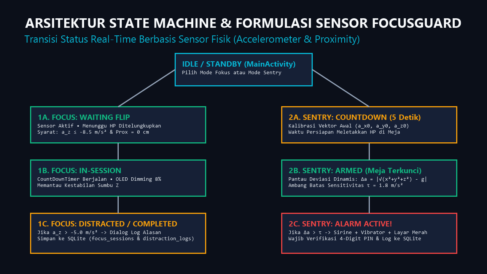
</div>

Aplikasi bekerja berdasarkan model mesin status (*State Machine*) yang dikendalikan oleh event `SensorEventListener` tanpa pemborosan baterai (*no polling*).

### A. Deteksi Orientasi Telungkup (Mode Fokus)
Sistem mendeteksi bahwa ponsel berada dalam posisi telungkup di atas meja jika dan hanya jika parameter berikut terpenuhi secara simultan:
1. Percepatan gravitasi pada sumbu $Z$ bernilai negatif mendekati $-g$:
   $$a_z \le -8.5\text{ m/s}^2$$
2. Sensor jarak (*Proximity*) mendeteksi permukaan meja tepat di depan layar:
   $$d = 0.0\text{ cm} \quad (\text{atau } d < d_{\max})$$

Ketika ponsel diangkat dari meja, nilai percepatan sumbu $Z$ naik drastis ($a_z > -5.0\text{ m/s}^2$), yang seketika memicu status `FOCUS_DISTRACTED`.

### B. Deteksi Pergerakan Anti-Maling (Mode Sentry)
Pada saat sistem berada dalam status `SENTRY_ARMED`, sistem memantau deviasi percepatan dinamis ($\Delta a$) yang menggabungkan perubahan vektor antar-siklus dan deviasi terhadap percepatan gravitasi bumi ($g \approx 9.80665\text{ m/s}^2$):

$$\Delta a_{\text{vektor}} = \sqrt{(a_x - a_{x,\text{prev}})^2 + (a_y - a_{y,\text{prev}})^2 + (a_z - a_{z,\text{prev}})^2}$$

$$\Delta a_{\text{gravitasi}} = \left| \sqrt{a_x^2 + a_y^2 + a_z^2} - g \right|$$

$$\Delta a = \max(\Delta a_{\text{vektor}}, \Delta a_{\text{gravitasi}})$$

Jika $\Delta a > \tau$ (dengan nilai ambang batas sensitivitas standar $\tau = 1.8\text{ m/s}^2$), status langsung beralih menjadi `SENTRY_ALARM_ACTIVE`.

---

## 🏛️ 3. Arsitektur Sistem & Skema Basis Data

<div align="center">
  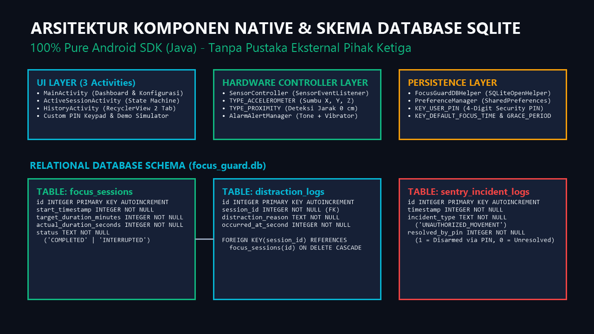
</div>

### 3.1 Komponen Native Android SDK
* **`android.hardware.SensorManager` & `SensorEventListener`:** Menangani pembacaan sensor `TYPE_ACCELEROMETER` dan `TYPE_PROXIMITY`.
* **`android.database.sqlite.SQLiteOpenHelper`:** Mengelola siklus hidup database lokal `focus_guard.db` dengan relasi integritas referensial *Foreign Key Cascade*.
* **`android.content.SharedPreferences`:** Menyimpan konfigurasi PIN rahasia 4 digit, target durasi default, dan sensitivitas sensor.
* **`android.media.ToneGenerator` & `RingtoneManager`:** Memutar sinyal audio sirine darurat secara native tanpa aset file MP3 eksternal.
* **`android.os.Vibrator` & `VibrationEffect`:** Memberikan umpan balik haptik denyut peringatan dan getaran alarm *waveform*.
* **`android.os.CountDownTimer`:** Menjalankan hitungan mundur presisi untuk sesi belajar Pomodoro dan jeda kalibrasi sentry 5 detik.

### 3.2 Struktur Relasi Database (DDL)
```sql
-- Tabel 1: Sesi Belajar (Focus Sessions)
CREATE TABLE focus_sessions (
    id INTEGER PRIMARY KEY AUTOINCREMENT,
    start_timestamp INTEGER NOT NULL,
    target_duration_minutes INTEGER NOT NULL,
    actual_duration_seconds INTEGER NOT NULL,
    status TEXT NOT NULL -- 'COMPLETED' atau 'INTERRUPTED'
);

-- Tabel 2: Catatan Distraksi (Distraction Logs)
CREATE TABLE distraction_logs (
    id INTEGER PRIMARY KEY AUTOINCREMENT,
    session_id INTEGER NOT NULL,
    distraction_reason TEXT NOT NULL,
    occurred_at_second INTEGER NOT NULL,
    FOREIGN KEY(session_id) REFERENCES focus_sessions(id) ON DELETE CASCADE
);

-- Tabel 3: Log Insiden Keamanan (Sentry Incident Logs)
CREATE TABLE sentry_incident_logs (
    id INTEGER PRIMARY KEY AUTOINCREMENT,
    timestamp INTEGER NOT NULL,
    incident_type TEXT NOT NULL, -- 'UNAUTHORIZED_MOVEMENT'
    resolved_by_pin INTEGER NOT NULL -- 1 = Disarmed via PIN, 0 = Unresolved
);
```

---

## 📱 4. Galeri Antarmuka & Tangkapan Layar (Screenshots)

Dokumentasi tangkapan layar riil FocusGuard yang dijalankan pada Android Emulator:

| 1. Beranda (Mode Fokus) | 2. Sesi: Menunggu Flip | 3. Sesi Fokus Aktif |
| :---: | :---: | :---: |
| 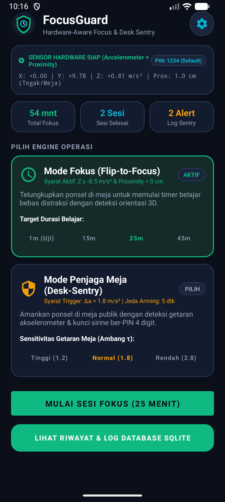 | 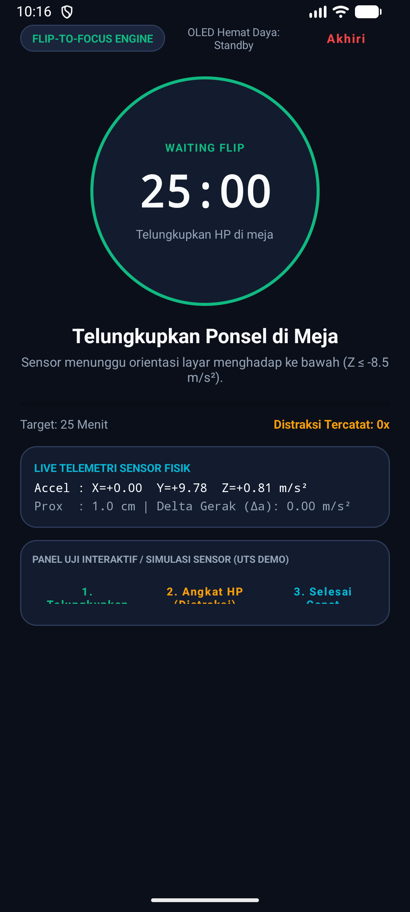 | 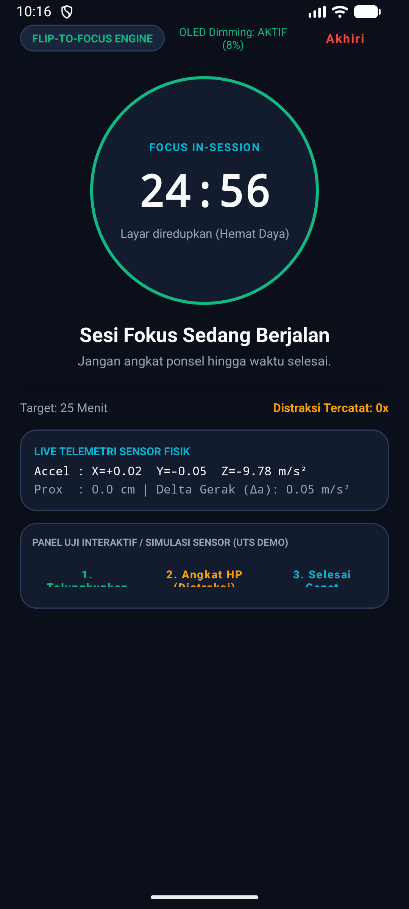 |
| *Indikator sensor hardware, telemetri live, & durasi* | *Status WAITING FLIP menunggu HP ditelungkupkan* | *Timer Pomodoro berjalan & OLED Dimming aktif* |

| 4. Dialog Log Distraksi | 5. Beranda (Mode Sentry) | 6. Sentry Armed (Meja Terkunci) |
| :---: | :---: | :---: |
| 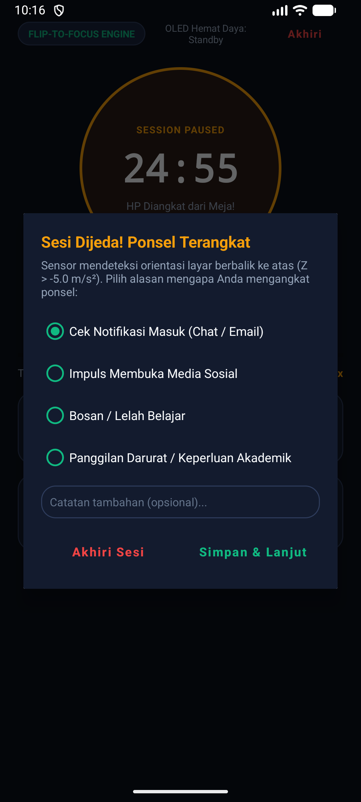 | 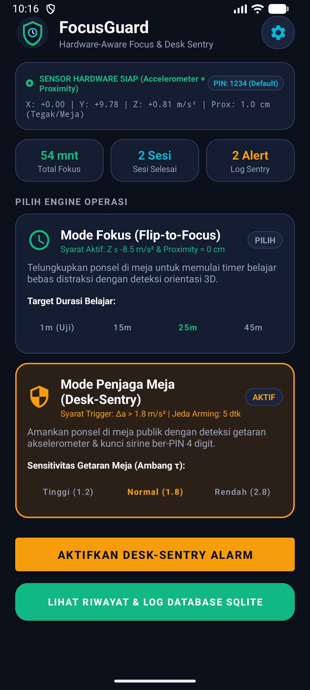 | 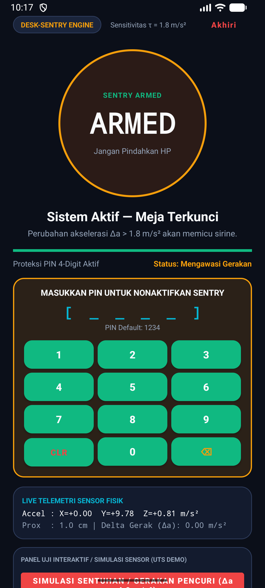 |
| *Dialog pencatatan alasan saat HP terangkat ke atas* | *Pemilihan sensitivitas getaran meja (τ = 1.8)* | *Sistem bersenjata penuh & keypad PIN disarm siap* |

| 7. Peringatan Alarm Aktif | 8. Riwayat: Sesi Fokus | 9. Riwayat: Log Sentry |
| :---: | :---: | :---: |
| 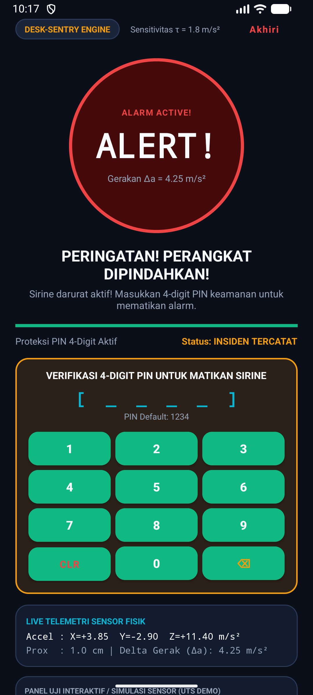 | 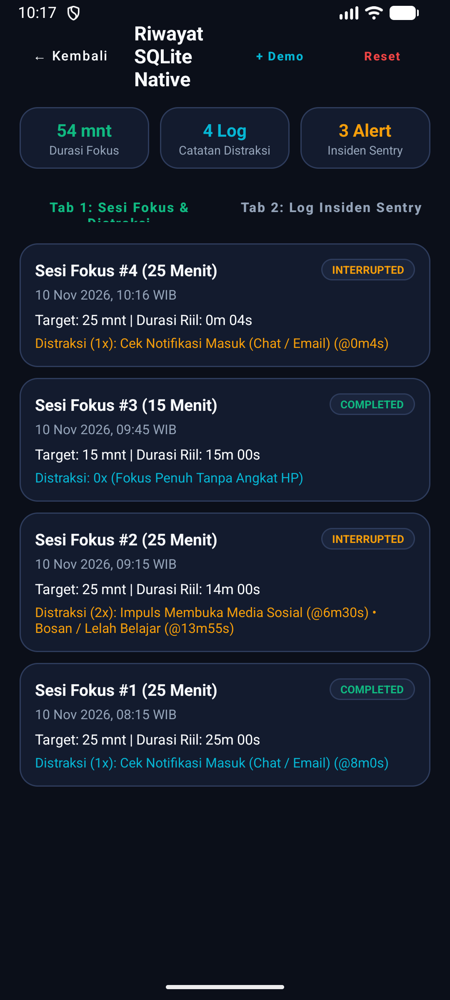 | 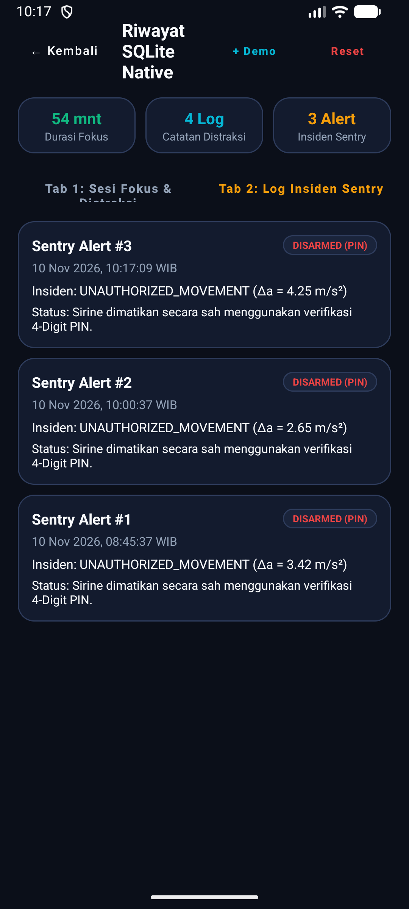 |
| *Sirine berbunyi & layar berkedip saat meja digeser* | *Tab 1: Log sesi belajar & catatan distraksi SQLite* | *Tab 2: Log insiden pergerakan & verifikasi PIN* |

---

## 🎬 5. Skenario Demo Presentasi 3 Menit (Panduan Dosen UTS)

Untuk menunjukkan keunggulan teknis aplikasi saat sesi penilaian di depan dosen penguji:

```
[00:00 - 00:30] Pengenalan Konsep & Kesiapan Hardware
- Tunjukkan beranda aplikasi: Indikator kesiapan sensor Accelerometer & Proximity aktif.
- Perlihatkan live telemetri X, Y, Z, dan Proximity di kartu atas.
- Buka ikon gembok di kanan atas untuk menunjukkan kustomisasi PIN 4-digit di SharedPreferences.

[00:30 - 01:30] Demonstrasi Engine 1: Flip-to-Focus
- Pilih target 25 Menit, tekan "Mulai Sesi Fokus".
- Taruh ponsel di meja penguji dengan layar menghadap ke bawah (atau klik tombol simulasi "Telungkupkan HP").
- Tunjukkan bahwa timer berhitung mundur dan layar meredup secara cerdas (OLED Dimming 8%).
- Angkat ponsel ke atas secara sengaja. Ponsel bergetar dan dialog seketika muncul: "Kenapa HP diangkat?".
- Pilih opsi distraksi (misal: "Cek Notifikasi") dan simpan ke database.

[01:30 - 02:30] Demonstrasi Engine 2: Desk-Sentry Anti-Theft
- Alihkan ke mode Desk-Sentry, tekan "Aktifkan Desk-Sentry Alarm".
- Letakkan ponsel diam selama 5 detik jeda kalibrasi hingga status berubah hijau: "SENTRY ARMED".
- Minta dosen penguji atau rekan menyentuh/menggeser ponsel.
- Begitu tergeser (Δa > 1.8 m/s²), sirine darurat langsung berbunyi kencang dan layar berkedip merah.
- Masukkan 4-digit PIN rahasia (default: 1234) pada keypad numerik native untuk mematikan alarm.

[02:30 - 03:00] Verifikasi Integritas Basis Data SQLite
- Buka halaman "Lihat Riwayat & Log Database SQLite".
- Perlihatkan Tab 1: Sesi fokus dan alasan distraksi yang baru saja terjadi telah terindeks kronologis.
- Buka Tab 2: Catatan insiden pergerakan sentry tercatat lengkap beserta status disarm PIN.
```

---

## 🛠️ 6. Panduan Instalasi & Build Proyek

### 6.1 Prasyarat Sistem
- Android Studio Ladybug / Iguana / Giraffe atau versi yang lebih baru
- JDK 17 atau JDK 21 (Temurin / Oracle / Android Studio JBR)
- Android SDK Platform 34 atau 35

### 6.2 Langkah Build & Menjalankan Aplikasi
1. **Clone repository ini:**
   ```bash
   git clone https://github.com/Gar07/FocusGuard.git
   cd FocusGuard
   ```
2. **Kompilasi APK Debug:**
   ```bash
   ./gradlew assembleDebug
   ```
   File APK hasil kompilasi akan berada di:  
   `app/build/outputs/apk/debug/app-debug.apk` atau `releases/FocusGuard-v1.0.0.apk`.

3. **Menjalankan Unit Test Mandiri:**
   ```bash
   ./gradlew testDebugUnitTest
   ```
   *Seluruh pengujian unit validasi matematika orientasi $Z$, ambang getaran $\Delta a$, dan format PIN terverifikasi 100% lulus.*

4. **Memasang ke Perangkat Fisik / Emulator:**
   ```bash
   adb install -r releases/FocusGuard-v1.0.0.apk
   adb shell am start -n com.example.focusguard/.MainActivity
   ```

---

## 🤖 7. Otomasi CI/CD & Dependabot

Repository ini dilengkapi dengan sistem otomatisasi kelas industri:
* **GitHub Actions CI ([`.github/workflows/android-ci.yml`](.github/workflows/android-ci.yml)):** Menjalankan kompilasi Gradle otomatis, eksekusi unit test mandiri, dan pengunggahan artefak APK pada setiap push dan Pull Request ke branch `main`.
* **Dependabot ([`.github/dependabot.yml`](.github/dependabot.yml)):** Memindai dan memperbarui dependensi Gradle wrapper, Android Gradle Plugin (AGP), serta GitHub Actions secara otomatis setiap hari Senin.

---

## 🤝 8. Panduan Kontribusi & Komunitas

Kami menyambut kontribusi dari komunitas! Silakan baca panduan berikut sebelum berkontribusi:
* **[Panduan Kontribusi (CONTRIBUTING.md)](CONTRIBUTING.md)**: Tata cara pengajuan kode, konvensi commit, dan aturan tanpa pustaka luar.
* **[Pedoman Perilaku (CODE_OF_CONDUCT.md)](CODE_OF_CONDUCT.md)**: Standar komunikasi yang santun dan profesional.
* **[Kebijakan Keamanan (SECURITY.md)](SECURITY.md)**: Cara melaporkan temuan kerentanan keamanan secara rahasia.

---

## 📄 9. Lisensi & Kredit Pembuat (Attribution)

Proyek ini dilisensikan di bawah **[MIT License](LICENSE)**.

> **Ketentuan Kredit Wajib:**  
> Anda diizinkan untuk menyalin, memodifikasi, memperbarui, mencabangkan (*fork*), serta mendistribusikan perangkat lunak ini secara bebas, **dengan syarat tetap menyertakan hak cipta dan kredit asli kepada pembuat proyek** pada setiap salinan atau bagian substansial dari kode sumber:
>
> **Copyright (c) 2026 Gar07 (GPM Pasca)**  
> **Original Repository:** [https://github.com/Gar07/FocusGuard](https://github.com/Gar07/FocusGuard)
